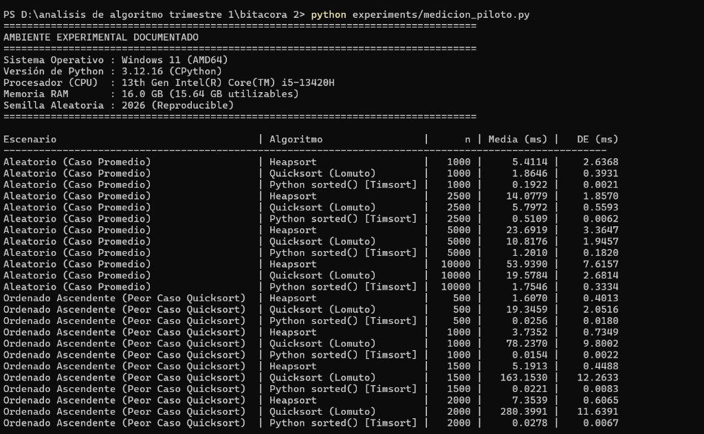
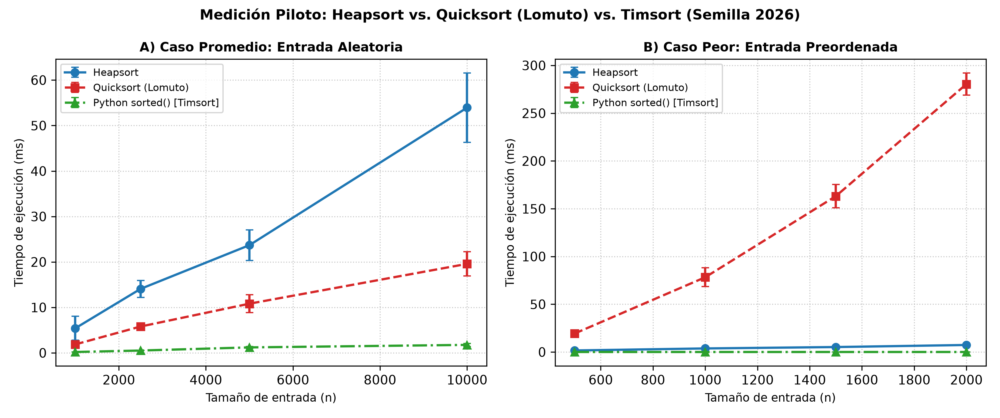

# Proyecto Integrador (Bitácora 2) — Equipo 1: Línea de Ordenamiento
## Priorización de Eventos Críticos del Centro de Cómputo de SIDOR con Heapsort y Quicksort de 3 Vías

**Maestría en Tecnologías de la Información — UNEG**  
**Asignatura:** Análisis y Diseño de Algoritmos (Cohorte X · 2026-III)  
**Docente:** Profa. MSc. Ana Isabel Sosa London  

---

### Descripción del Problema y Caso de Uso Realista (SIDOR)

En el **Centro de Cómputo de la Siderúrgica del Orinoco (SIDOR)**, los sistemas de supervisión SCADA y telemetría de planta (Hornos de Arco Eléctrico, Reducción Directa Midrex y Trenes de Laminación) generan ráfagas masivas de telemetría y alarmas técnicas que se consolidan en ventanas rodantes de 60 segundos.

Cada evento se modela con la tupla `(id, timestamp, origen, criticidad)` calculada mediante la métrica ponderada:
`criticidad = 100 × Severidad + 10 × Impacto + 5 × Desviación` (rango normalizado entre 0 y 1000).

Para garantizar la toma de decisiones operativas y la trazabilidad histórica, el sistema genera dos salidas principales:

1. **Tablero Gerencial de Respuesta Rápida (S₁):**
   - **Objetivo:** Filtrar y visualizar de inmediato los `k` eventos más críticos (`k = 10`) en menos de 1 segundo.
   - **Algoritmo:** Max-Heap con extracción parcial mediante `top_k`.
   - **Complejidad:** Tiempo casi-lineal `Θ(n + k log n)` y espacio auxiliar estricto `O(1)` in-place (o `O(k)` para el resultado desacoplado).

2. **Reporte Consolidado de Cierre de Turno (S₂):**
   - **Objetivo:** Ordenar la totalidad de los eventos del turno de forma descendente por la clave compuesta `(criticidad, -timestamp, -id)`.
   - **Algoritmos:**
     - **Heapsort:** Garantiza una cota asintótica estricta `Θ(n log n)` tanto en el mejor, promedio como en el peor caso, con memoria auxiliar mínima `O(1)`. Ideal para entornos de misión crítica con límites de memoria física.
     - **Quicksort Aleatorizado de 3 Vías:** Utiliza partición ternaria (`particionar_3v`) que agrupa claves idénticas (`< pivote`, `= pivote`, `> pivote`). Reduce el tiempo de ejecución a `Θ(n)` frente a inundaciones masivas de eventos repetidos y garantiza profundidad de recursión `O(log n)`.

---

## Estructura del Repositorio

El repositorio cumple con la estructura exigida en las especificaciones de entrega:

```text
bitacora 2/
├── README.md                           # Instrucciones de reproducción, ambiente y resultados
├── requirements.txt                    # Dependencias del proyecto (hypothesis, matplotlib)
├── Equipo1_Bitacora2.docx              # Documento consolidado del equipo (Puntos 1 al 9)
├── src/
│   ├── __init__.py
│   ├── eventos.py                      # Modelo EventoSidor, clave de prioridad y generador de lotes (semilla 2026)
│   └── ordenamiento.py                 # Implementaciones: Max-Heap, Heapsort, Quicksort 3-vías y Quicksort Lomuto
├── tests/
│   └── test_ordenamiento.py            # 9 pruebas automatizadas (unitarias, límites, Hypothesis y diferencial)
└── experiments/
    ├── medicion_piloto.py              # Script de benchmarking experimental (semilla 2026 reproducible)
    ├── captura_consola_piloto.jpg      # Evidencia visual de la ejecución en consola local
    └── grafica_piloto.png              # Gráfica comparativa generada (Caso Promedio vs. Peor Caso)
```

---

## Ambiente Experimental Documentado

Las mediciones del Punto 8 fueron recolectadas en el siguiente entorno de hardware y software:

| Componente | Especificación Técnica |
| :--- | :--- |
| **Procesador (CPU)** | 13th Gen Intel(R) Core(TM) i5-13420H @ 2.10 GHz (12 hilos lógicos) |
| **Memoria RAM** | 16.0 GB DDR5 (15.64 GB utilizables) |
| **Sistema Operativo** | Windows 11 Home Single Language (64 bits, arquitectura AMD64) |
| **Versión de Python** | Python 3.12.16 (CPython, build oficial de 64 bits) |
| **Semilla Aleatoria** | `2026` (Fijada para total reproducibilidad de los lotes sintéticos) |
| **Temporizador** | `time.perf_counter()` de alta precisión monotónica |

---

## Instrucciones para Reproducir Todo

### 1. Clonar o acceder a la carpeta del proyecto

```powershell
cd "D:\analisis de algoritmo trimestre 1\bitacora 2"
```

### 2. Instalar las dependencias requeridas

```powershell
python -m pip install -r requirements.txt
```

*(Dependencias mínimas: `hypothesis` para pruebas de propiedades y `matplotlib` para la generación de gráficos).*

### 3. Ejecutar la batería completa de pruebas automatizadas

```powershell
python -m unittest discover -s tests -p "test_*.py" -v
```

**Resultado esperado:** 9 pruebas superadas exitosamente en ~1.5 segundos:
- `test_01_limites_vacio_y_unitario` (Casos límite: lista vacía y lista de 1 elemento)
- `test_02_inundacion_claves_iguales` (Inundación de 2.000 alarmas con claves idénticas)
- `test_03_entradas_ordenadas_e_invertidas` (Comportamiento con entradas preordenadas e invertidas)
- `test_04_bordes_parametro_top_k` (Casos límite para el parámetro k: k=0, k > n, k=n)
- `test_05_invariantes_heap_y_particion_3v` (Comprobación estructural del invariante de Max-Heap y partición ternaria)
- `test_06_caso_uso_sidor_alto_horno_y_laminador` (Escenario realista de emergencia industrial en SIDOR)
- `test_07_propiedad_orden_y_multiconjunto` (Hypothesis: invariante de permutación y orden descendente estricto)
- `test_08_propiedad_top_k_contra_sorted` (Hypothesis: equivalencia matemática de top_k)
- `test_09_diferencial_eventos_sidor` (Prueba diferencial estricta contra `sorted()` de Python)

### 4. Ejecutar el experimento de medición piloto

```powershell
python experiments/medicion_piloto.py
```

El script imprimirá la tabla de tiempos y generará automáticamente la figura `experiments/grafica_piloto.png`.

---

## Resultados de la Medición Piloto (Punto 8)

Los tiempos promedio obtenidos tras 5 repeticiones independientes sobre copias exactas del lote con semilla `2026` fueron:

### Escenario 1: Lote Aleatorio de SIDOR (Caso Promedio)

| Tamaño de Entrada (n) | Heapsort (ms) | Quicksort 3 Vías (ms) | Python sorted() [Timsort] (ms) |
| :---: | :---: | :---: | :---: |
| **1.000** | 5.41 ± 2.64 | 1.86 ± 0.39 | 0.19 ± 0.00 |
| **2.500** | 14.08 ± 1.86 | 5.80 ± 0.56 | 0.51 ± 0.01 |
| **5.000** | 23.69 ± 3.36 | 10.82 ± 1.95 | 1.20 ± 0.18 |
| **10.000** | 53.94 ± 7.62 | 19.58 ± 2.68 | 1.75 ± 0.33 |

> **Hallazgo:** En el caso promedio, Quicksort supera a Heapsort por un factor de **2.75×** a **2.90×** debido a un menor factor constante y una óptima localidad espacial de referencia en caché de CPU.

### Escenario 2: Lote Pre-ordenado (Peor Caso para Partición Lomuto)

| Tamaño de Entrada (n) | Heapsort (ms) | Quicksort Lomuto (ms) | Python sorted() [Timsort] (ms) |
| :---: | :---: | :---: | :---: |
| **500** | 1.61 ± 0.40 | 19.35 ± 2.05 | 0.03 ± 0.02 |
| **1.000** | 3.74 ± 0.73 | 78.24 ± 9.80 | 0.02 ± 0.00 |
| **1.500** | 5.19 ± 0.45 | 163.15 ± 12.26 | 0.02 ± 0.01 |
| **2.000** | 7.35 ± 0.61 | 280.40 ± 11.64 | 0.03 ± 0.01 |

> **Hallazgo:** Mientras Quicksort con partición determinista colapsa a comportamiento cuadrático `O(n²)` (280.40 ms para apenas n=2.000), Heapsort mantiene su cota `O(n log n)` intacta (7.35 ms, una ventaja de **38×**), confirmando su robustez para sistemas de misión crítica.

---

## Evidencias Visuales

### Captura de Consola (Ejecución Real en el Equipo)



### Gráfica Comparativa del Comportamiento Asintótico



---

## Matriz de Cumplimiento de la Rúbrica (Bitácora 2)

| Requisito de la Asignación | Estado | Implementación / Ubicación |
| :--- | :---: | :--- |
| **Algoritmos mínimos:** Heapsort y Quicksort | **Completo** | `src/ordenamiento.py` (Heapsort in-place, Quicksort 3-vías y Quicksort Lomuto). |
| **Punto 6:** Código Python 3 funcional y legible | **Completo** | Código estructurado, PEP 8, nombres de dominio industrial SIDOR, modularizado en `src/`. |
| **Punto 7:** Mínimo 5 unitarias (límites) | **Completo** | 6 pruebas unitarias implementadas en `tests/test_ordenamiento.py`. |
| **Punto 7:** 2 pruebas con Hypothesis | **Completo** | 2 pruebas basadas en propiedades (`test_07` y `test_08`). |
| **Punto 7:** 1 prueba diferencial contra `sorted()` | **Completo** | 1 prueba diferencial estricta (`test_09`) contra `sorted()` y `heapq.nlargest()`. |
| **Punto 7:** Semilla fija y reproducible | **Completo** | Semilla `2026` fijada en el generador y en el script experimental. |
| **Punto 8:** Al menos 3 tamaños de entrada | **Completo** | 4 tamaños evaluados en caso promedio (1.000 a 10.000) y 4 en peor caso (500 a 2.000). |
| **Punto 8:** Al menos 3 repeticiones | **Completo** | 5 repeticiones por cada configuración (calculando media y desviación estándar). |
| **Punto 8:** Ambiente documentado (CPU, RAM, Python) | **Completo** | Especificaciones de Intel Core i5-13420H, 16 GB RAM, Windows 11, Python 3.12.16. |
| **Punto 8:** Gráfica comparativa | **Completo** | Generada en `experiments/grafica_piloto.png` (resolución 300 DPI, escala logarítmica). |
| **Punto 8:** ½ página con plan Parte 2 e hipótesis | **Completo** | Redactada y formateada en `Equipo1_Bitacora2.docx` con hipótesis H₁, H₂, H₃ y gráfica insertada. |
| **Estructura del Repositorio:** README, requirements, src, tests, experiments | **Completo** | Estructura de carpetas normalizada y verificada. |
